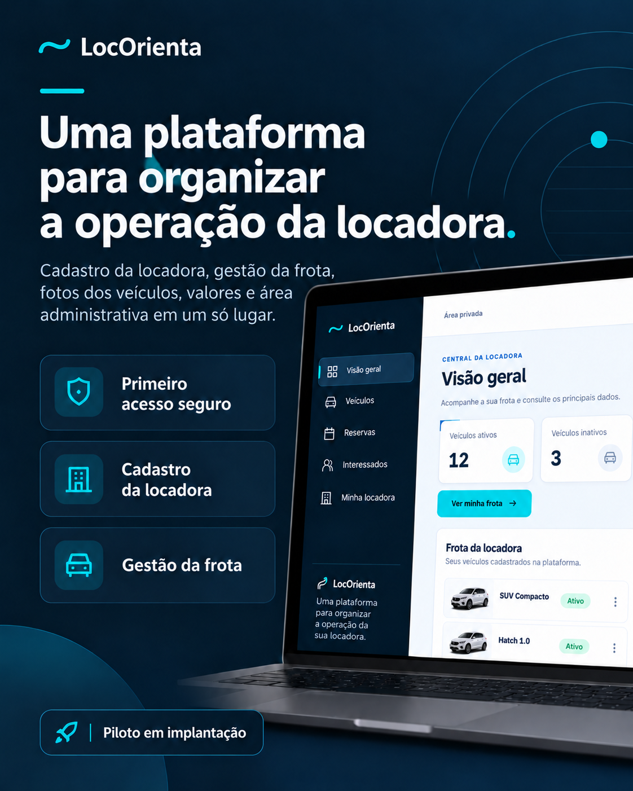
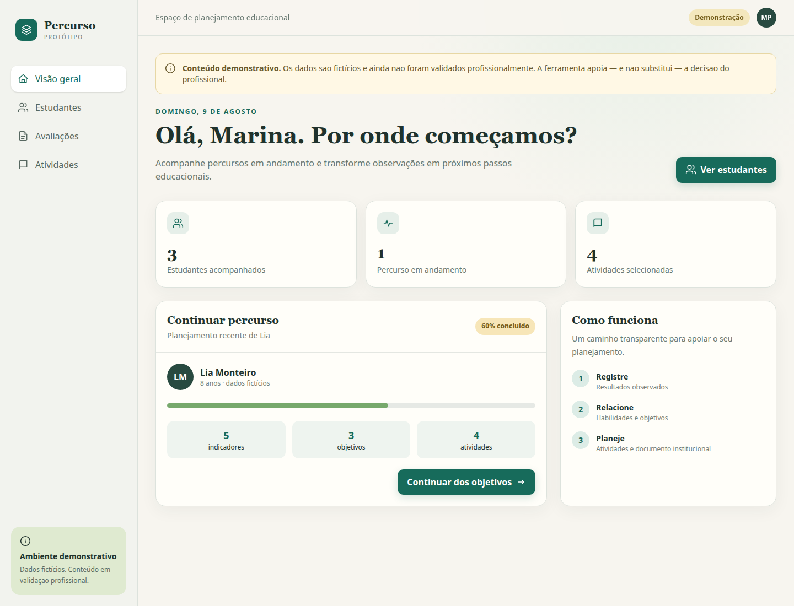

# Wallancy Raniery

**Desenvolvedor de Software e Produto** · Backend e full-stack · Soluções SaaS para operações reais

Construo software para transformar processos e necessidades de negócio em produtos digitais utilizáveis. Atuo da compreensão do problema à implementação, com atenção a **modelagem de dados, segurança, testes automatizados, arquitetura e experiência de uso**.

Na **Improve**, participo da definição e evolução de soluções de software, conectando estratégia de produto e execução técnica. Minha experiência anterior em operações industriais e processos SMD complementa minha forma de analisar problemas, confiabilidade e melhoria contínua.

## Tecnologias

| Área | Stack e práticas |
| --- | --- |
| Backend e dados | Python, Node.js, TypeScript, PostgreSQL, SQL, APIs REST, Drizzle ORM |
| Web | React, Next.js, JavaScript, TypeScript |
| Infraestrutura e qualidade | Docker, Linux, Git, GitHub Actions, Supabase, Vercel, testes automatizados, CI, migrations |
| Produto e engenharia | Discovery, modelagem de domínio, controle de acesso, integração de sistemas, documentação técnica |

## Projetos em destaque

### 🚗 [LocOrienta — SaaS para locadoras de veículos](projects/locorienta.md)

**Implantação piloto · Código-fonte privado**

Plataforma para cadastro de locadoras, gestão de frota, fotografias e valores dos veículos, vitrine pública individual e acompanhamento de interessados. Inclui autenticação, primeiro acesso assistido, isolamento entre organizações, testes e validações de segurança.

*Mockup ilustrativo com dados demonstrativos. Clique para conhecer a apresentação técnica.*

O envio de interesse não confirma reserva nem garante disponibilidade. Reservas e pagamentos não são anunciados como operação comercial.

**[Conhecer o produto](https://locacao-carros.vercel.app) · [Ver apresentação técnica pública](projects/locorienta.md)**

[Fluxo do produto](projects/locorienta.md#como-a-plataforma-funciona) · [Visuais ilustrativos](projects/locorienta.md#demonstrações-visuais) · [Arquitetura e segurança](projects/locorienta.md#engenharia-e-tecnologias) · [Evidências e limites](projects/locorienta.md#evidências-e-limites-de-validação)

### ♿ [Percurso — Educação Inclusiva](projects/percurso.md)

**Repositório público · Protótipo em Discovery**

Protótipo navegável com fluxo de avaliação, indicadores, habilidades, objetivos, atividades e composição demonstrativa de documento educacional. Desenvolvido com Next.js, React, TypeScript, regras de domínio explícitas, dados fictícios e testes. **Não é uma solução clínica ou institucional validada.**

*Captura real do protótipo local com dados fictícios. Clique para conhecer a apresentação técnica.*

**[Ver apresentação técnica e capturas](projects/percurso.md) · [Explorar o código público](https://github.com/wallancyraniery/educacao_inclusiva)**

## Formação e trajetória

Curso **Ciência da Computação**, com previsão de conclusão em **dezembro de 2028**. Trago experiência anterior em operações industriais, análise de processos, resolução de problemas e melhoria contínua para o desenvolvimento de software.

## Oportunidades e colaboração

Tenho interesse em posições de **desenvolvimento backend ou full-stack**, além de projetos e parcerias para digitalização de operações e criação de produtos. Disponível para trabalho remoto, híbrido, presencial e mudança de cidade.

**Contato:** [LinkedIn](https://www.linkedin.com/in/wallancyraniery/) · [GitHub](https://github.com/wallancyraniery)

---

English summary

Software developer working across **backend, full-stack engineering and product development**, with experience in TypeScript, Next.js, React, Python, PostgreSQL, Docker, Supabase, and automated testing.

I help build practical software solutions for operational problems, from requirements and product decisions to architecture, implementation, security and validation. Current highlights include **LocOrienta** (private-code SaaS in pilot deployment) and **Percurso**, a public inclusive-education discovery prototype.

Open to backend/full-stack roles, software projects and collaboration.

