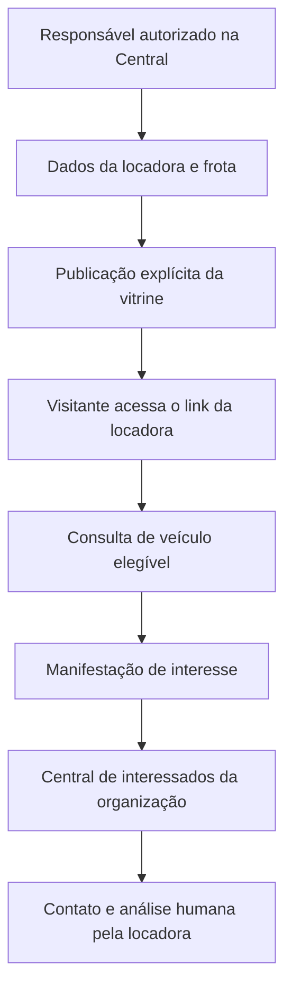
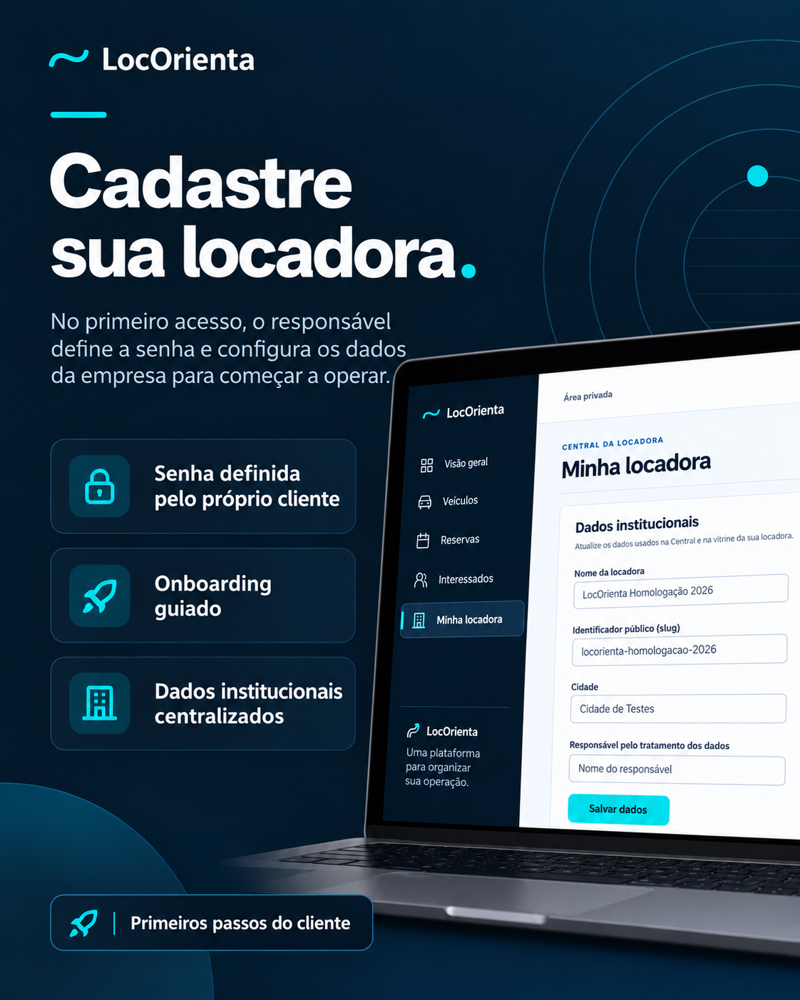
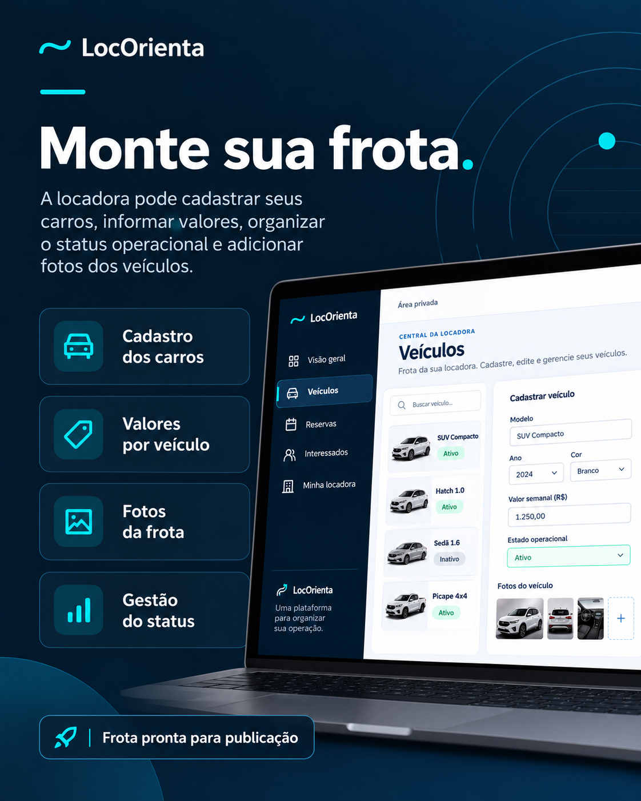
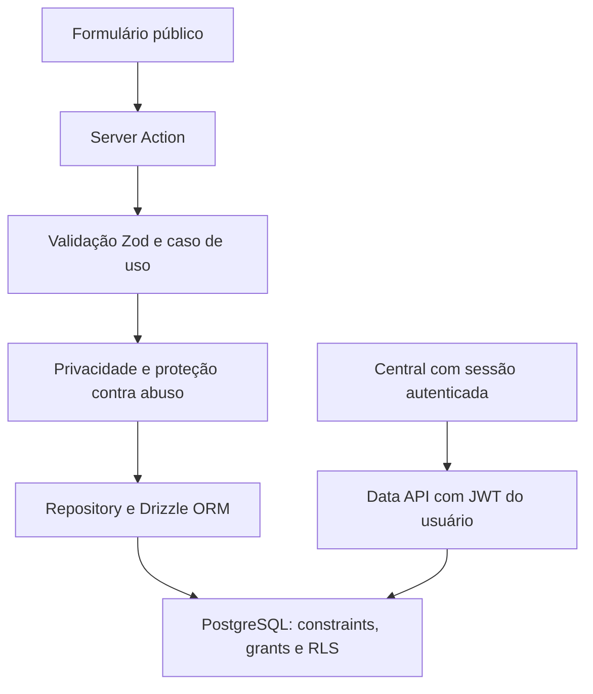

# LocOrienta — plataforma SaaS para locadoras de veículos

**Produto da Improve · Implantação piloto · Código-fonte privado**

[Conhecer a página pública](https://locacao-carros.vercel.app) · [Voltar ao perfil](../README.md)

[Funcionamento](#como-a-plataforma-funciona) · [Visuais](#demonstrações-visuais) · [Engenharia](#engenharia-e-tecnologias) · [Evidências](#evidências-e-limites-de-validação)

> A manifestação de interesse inicia um atendimento humano. Não confirma reserva, aprovação ou disponibilidade e não bloqueia um veículo.

## O problema

Pequenas locadoras precisam apresentar seus veículos, manter informações da frota organizadas e atender pessoas interessadas sem depender de controles dispersos.

A **LocOrienta** reúne uma vitrine pública própria para cada locadora e uma **Central privada** para a operação inicial.

## Escopo implementado e condições do piloto

| Área | Entrega |
| --- | --- |
| Primeiro acesso | Entrada assistida com validações anteriores em Supabase Auth real; o novo convite nativo sem senha provisória está implementado, mas ainda depende de homologação remota própria |
| Organização | Onboarding da locadora e atualização de dados institucionais pelo proprietário |
| Frota | Cadastro e acompanhamento de veículos, valores e estados operacionais; mídia implementada, dependente da configuração e validação do Storage |
| Vitrine pública | Página da locadora identificada por endereço próprio, com publicação e despublicação controladas |
| Interessados | Formulário público para manifestação de interesse e acompanhamento na Central |
| Proteção de dados | Autorização por organização, políticas no banco de dados e separação entre dados públicos e privados |

## Como a plataforma funciona

O responsável autorizado configura a locadora e cadastra os veículos na Central. A publicação da vitrine é uma decisão explícita do proprietário. O visitante acessa o link compartilhado pela própria locadora, consulta os veículos elegíveis e pode manifestar interesse.

**Leitura do fluxo:** Central → publicação → vitrine → interesse → atendimento humano. O diagrama explica o funcionamento implementado; não é captura de tela nem prova de execução em produção. A Home apresenta o produto; a vitrine individual é acessada pelo link da locadora.

## Demonstrações visuais

Os mockups comerciais abaixo são **ilustrativos e usam dados demonstrativos**. Eles apresentam a proposta do produto, sem reproduzir exatamente as telas do sistema hospedado. Números, veículos e controles desenhados nas imagens são exemplos, não evidências de uso comercial.

### Plataforma e Central privada

A LocOrienta organiza o cadastro da empresa, as informações da frota, os valores e as fotografias dos veículos, com acesso administrativo autorizado e uma vitrine pública para apresentação dos carros.

*Mockup ilustrativo de visão geral. Os contadores e o item “Reservas” são elementos de apresentação, sem comprovar volume de uso ou operação de reservas.*

### Cadastro da locadora

No novo fluxo de convite implementado, a definição de senha, a ativação administrativa e o novo login antecedem o cadastro inicial da locadora. Esse novo convite ainda requer homologação remota; as validações anteriores de ativação e onboarding pertencem ao fluxo assistido com senha provisória. Essa etapa reúne dados institucionais, identificador público e informações de contato e privacidade. A entrada no piloto é assistida, sem cadastro público irrestrito.

*Mockup ilustrativo de cadastro. O piloto exige acesso assistido, ativação e novo login antes do onboarding; a imagem resume essas etapas.*

### Gestão da frota

O cadastro reúne marca e modelo, ano, cor e versão, valor semanal, estado operacional e fotografias dos veículos. Essas informações apoiam a organização da frota e a preparação da vitrine pública.

*Mockup ilustrativo de frota. Veículos, valores, busca e controles desenhados são exemplos visuais; não comprovam a disponibilidade de cada interação no sistema hospedado.*

### Vitrine pública e Central administrativa

A Central é a área privada da locadora, com acesso autorizado aos módulos de visão geral, frota, interessados e informações institucionais. Ela apoia a gestão inicial; a presença de “Reservas” nos mockups não significa uma operação comercial completa de reservas.

**Limite visual:** esta página não inclui capturas funcionais verificadas da vitrine ou da Central. Os mockups explicam a proposta; o fluxo e a arquitetura são diagramas conceituais. Uma galeria funcional dependerá de capturas em ambiente local ou demonstrativo, com dados sintéticos e origem registrada.

**Conheça a LocOrienta**

[https://locacao-carros.vercel.app](https://locacao-carros.vercel.app)

A Central administrativa permanece restrita a contas autorizadas, com entrada assistida durante a implantação piloto.

## Engenharia e tecnologias

| Camada | Tecnologias e práticas |
| --- | --- |
| Aplicação | Next.js, React e TypeScript |
| Backend e persistência | PostgreSQL, Supabase e Drizzle ORM |
| Qualidade | Validação de entrada, testes automatizados, integração PostgreSQL, lint e typecheck |
| Operação | Docker para desenvolvimento, GitHub Actions e Vercel |
| Segurança | Autenticação, isolamento entre locadoras, controle de permissões e políticas de acesso no banco |

### Arquitetura do fluxo de interesse

**Leitura da arquitetura:** o formulário passa por validação no servidor, verificações de privacidade e proteção contra abuso antes da persistência. A Central usa uma fronteira autenticada distinta. O diagrama resume responsabilidades, sem representar toda a infraestrutura ou comprovar sua configuração remota.

### Decisões de engenharia

| Decisão implementada | Problema tratado |
| --- | --- |
| Módulos de domínio, casos de uso e repositories | Separar regras de negócio, interface e acesso a dados para permitir testes e evolução controlada |
| Validação no servidor e consultas parametrizadas | Recusar entradas inválidas e controlar a persistência |
| Organização e veículo resolvidos no servidor | Evitar confiar em contexto de autorização enviado pelo navegador |
| RLS, grants mínimos e permissões por organização | Restringir leitura e ações ao contexto autorizado da locadora |
| Credencial de intake separada da autenticação da Central | Limitar o formulário público às operações necessárias, sem credencial administrativa na aplicação |
| Projeções públicas restritas e publicação explícita | Expor somente dados destinados à vitrine de uma locadora publicada |
| Migrations versionadas e integração PostgreSQL isolada | Verificar integridade e autorização com o banco real em ambiente de testes |

A implementação usa **Next.js App Router, React, TypeScript, Zod, Drizzle ORM e PostgreSQL**. A Central integra autenticação Supabase com sessão validada no servidor. A entrada no piloto é assistida, sem cadastro público irrestrito.

### Evidências e limites de validação

Esta apresentação foi confrontada com a documentação, módulos de interesse e vitrine, acesso a interessados e configuração de CI do código privado. A inspeção comprova a existência desses contratos no código consultado; não substitui execução ou auditoria independente.

| Evidência disponível | Alcance e limite |
| --- | --- |
| Testes unitários e de componentes versionados | Cobrem validação, regras, ações e renderização; resultados atuais não foram reexecutados nesta revisão documental |
| Suítes de integração PostgreSQL versionadas | Exercitam integridade, autorização e isolamento em banco local de testes; não comprovam políticas do ambiente hospedado |
| Pipeline GitHub Actions configurado | Prevê typecheck, lint, testes, migrations locais e build; a configuração não comprova a última execução |
| Homologações humanas registradas na documentação técnica | Incluem navegação sintética na Central em Preview e observações anteriores de Home, login, vitrine e status; não foram repetidas nesta revisão |
| Primeiro acesso assistido anterior — Supabase Auth real | A documentação versionada registra operações confirmadas pelo responsável: alteração de senha comprovada por Audit Log, ativação, revogação, reativação e corte de sessões; essas validações usaram senha provisória e não foram repetidas nesta revisão |
| Autorização e onboarding anteriores — ambiente real | A mesma fonte registra onboarding por RPC com criação automática do owner e isolamento de leitura entre três organizações; são evidências anteriores, distintas dos testes locais e do novo convite |
| Novo convite nativo sem senha provisória | Implementado e coberto por testes locais; a documentação técnica declara pendente a homologação com Supabase Auth real. As validações do fluxo anterior não comprovam este novo convite |
| Imagens desta página | Mockups ilustrativos com dados demonstrativos; nenhuma é evidência funcional |

**Origem e alcance:** a documentação técnica versionada distingue as operações históricas do primeiro acesso assistido (checkpoints 2C, confirmadas pelo responsável) da implementação posterior do convite nativo (2D.3). As evidências anteriores de Auth real, controle de acesso e onboarding permanecem válidas no alcance registrado. Elas não homologam geração, aceitação, expiração ou uso único do novo convite. A trilha primária completa das operações remotas não foi examinada nesta revisão documental.

Testes locais, homologação de um fluxo e publicação de uma revisão são evidências distintas. Storage, proteção contra abuso e autenticação dependem de configuração e validação próprias no ambiente de destino. Esta página não declara segurança integral nem homologação completa do piloto.

## Limites do estágio atual

A LocOrienta **não oferece ainda uma operação comercial completa de reservas ou pagamentos**. Manifestação de interesse não equivale a reserva confirmada. Funcionalidades e fluxos seguem evoluindo conforme a implantação e o retorno dos usuários.

O [site público](https://locacao-carros.vercel.app) apresenta a proposta do produto. A Central exige uma conta autorizada.

> **Código privado por decisão de produto e segurança.** Esta apresentação explica o escopo e as competências técnicas sem disponibilizar credenciais, arquivos internos, infraestrutura sensível ou dados de clientes.

## Meu papel

Participo da construção da LocOrienta conectando **decisões de produto, desenvolvimento de software, arquitetura, segurança, testes e implantação** na Improve.

Tenho interesse em oportunidades de desenvolvimento **backend e full-stack**, projetos sob medida e parcerias para criar soluções úteis para operações reais.

[LinkedIn](https://www.linkedin.com/in/wallancyraniery/) · [Perfil no GitHub](https://github.com/wallancyraniery)
