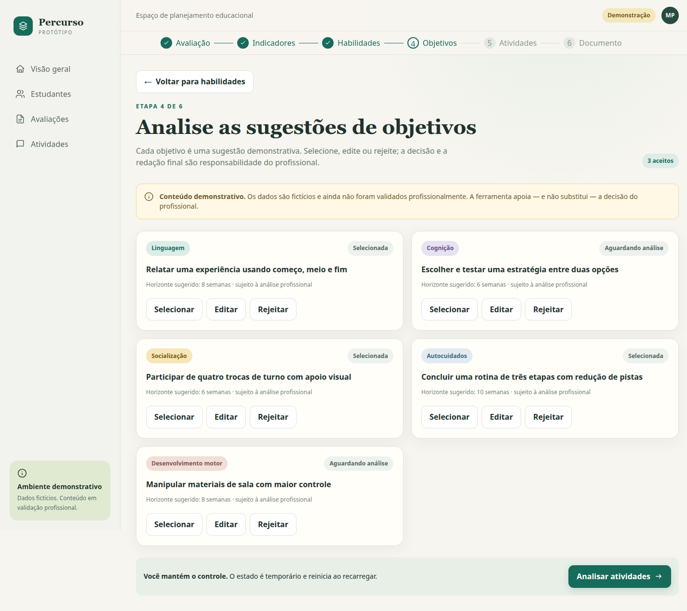
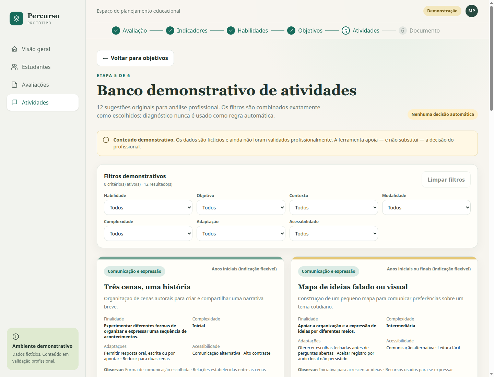
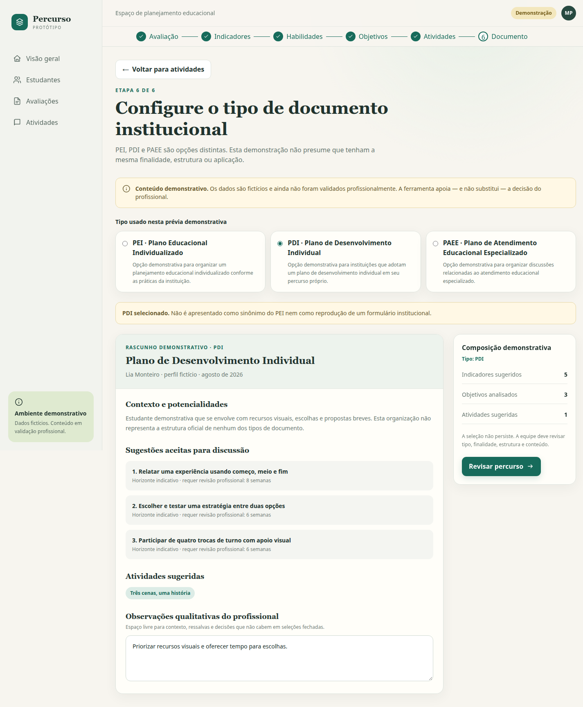

# Percurso — Educação Inclusiva

**Protótipo em Discovery · Código público · Dados fictícios**

[Repositório do protótipo](https://github.com/wallancyraniery/educacao_inclusiva) · [Voltar ao perfil](../README.md)

[Funcionamento](#como-o-percurso-é-explorado) · [Capturas reais](#capturas-reais-do-protótipo) · [Engenharia](#engenharia-e-organização) · [Evidências e limites](#evidências-e-limites)

> Demonstração para investigar um problema de produto com profissionais. Não é uma solução clínica ou institucional validada, nem produz documentos oficiais.

## O problema investigado

Como apoiar profissionais da educação inclusiva na passagem de observações de uma avaliação para um planejamento de ações educacionais? O Percurso explora essa hipótese por meio de um protótipo navegável, antes de definir uma arquitetura de produção.

O objetivo do Discovery é verificar se a sequência proposta representa o raciocínio dos profissionais, quais informações ajudam a decidir e onde as sugestões precisam de contexto. A identidade “Percurso” é provisória; as telas não demonstram adoção institucional ou atendimento real.

## Como o percurso é explorado

**Avaliação → Indicadores → Habilidades → Objetivos → Atividades → Documento institucional**

| Etapa | O que a demonstração permite explorar |
| --- | --- |
| Avaliação | Registro temporário de observações genéricas em cinco áreas, sem reproduzir um instrumento oficial |
| Indicadores e habilidades | Exposição de sugestões e associações locais para discussão profissional |
| Objetivos | Análise, seleção, edição e rejeição de sugestões demonstrativas |
| Atividades | Consulta de 12 atividades originais, filtros combinados, detalhes e decisão explícita de selecionar ou rejeitar |
| Documento | Configuração de tipo e composição de uma prévia demonstrativa na rota `/pei`, com as atividades selecionadas na sessão |

### Regras e responsabilidade profissional

As associações são funções puras: indicadores se relacionam com habilidades por identificadores, habilidades com objetivos, e objetivos com atividades. No catálogo, os filtros de habilidade, objetivo, contexto, modalidade, complexidade, adaptação e acessibilidade são combinados com lógica **E**. Se nenhum item atende a todos os critérios, o estado vazio mantém os filtros; não cria resultados nem relaxa escolhas.

As sugestões de atividades exigem autoria, licença, versão e estado editorial preenchidos. Isso é uma barreira de integridade do conteúdo demonstrativo, não uma validação pedagógica. O profissional continua responsável por analisar pertinência, adaptar propostas, revisar a redação e decidir o que utilizar. Diagnóstico não é usado como regra automática.

**Limite do encadeamento:** o fluxo representa a hipótese de produto. Há exemplos e contadores predefinidos no painel, nos indicadores e nos objetivos. A tela de objetivos inicia com três sugestões selecionadas; a prévia final usa três objetivos fixos e não incorpora automaticamente as edições dessa tela. As escolhas de atividades, por sua vez, são compartilhadas entre catálogo, detalhes, documento e resumo durante a navegação. Tudo permanece em memória e reinicia ao recarregar; não há salvamento durável.

### PEI, PDI e PAEE

A rota `/pei` reúne três opções distintas. Os nomes abaixo são os utilizados pelo protótipo e não definem um padrão obrigatório para instituições.

| Opção | Nome na demonstração | Limite apresentado |
| --- | --- | --- |
| PEI | Plano Educacional Individualizado | Finalidade, composição e nomenclatura devem ser confirmadas pela equipe responsável |
| PDI | Plano de Desenvolvimento Individual | Não é tratado como sinônimo do PEI nem como reprodução de formulário institucional |
| PAEE | Plano de Atendimento Educacional Especializado | Escopo depende da definição profissional e do contexto institucional |

As prévias organizam uma discussão sobre conteúdo e responsabilidades. Não substituem revisão profissional, não representam formulários oficiais e não comprovam adequação clínica, institucional ou legal.

## Capturas reais do protótipo

As quatro imagens abaixo são **capturas reais de navegador**, feitas localmente com os dados fictícios já versionados. Não são mockups ou imagens geradas. Nomes, datas, contadores e perfis pertencem à demonstração; não representam pessoas ou resultados reais.

Origem: `http://127.0.0.1:3107`, Chrome headless, viewport desktop **1440 × 1100**, commit [`e7098ca`](https://github.com/wallancyraniery/educacao_inclusiva/commit/e7098ca5f9898039889187ee6bb3cb9ba78e51f2). A [ficha das capturas](assets/percurso/capturas.md) registra rotas, enquadramentos, ações, dimensões e hashes. Clique em uma imagem para inspecionar o original.

### Painel inicial

*Rota `/`. Os contadores, o percentual de conclusão e a data são exemplos predefinidos, sem comprovar uso real ou refletir necessariamente as seleções da sessão.*

### Análise de objetivos

*Rota `/objetivos`, página inteira. A imagem preserva o estado inicial da demonstração. Editar, rejeitar e selecionar foram também exercitados no navegador; isso não comprova validação profissional dos objetivos.*

### Banco demonstrativo de atividades

*Rota `/atividades`, enquadramento do viewport. A amostra local contém 12 atividades originais e não validadas profissionalmente, distribuídas em quatro domínios. O catálogo começa sem decisões de seleção.*

### Composição demonstrativa de documento

*Rota `/pei`, página inteira, após selecionar “Três cenas, uma história” no catálogo e seguir pelo link de continuidade. O PDI é a opção inicial do protótipo; a captura mantém avisos, contagem de uma atividade e observações fictícias existentes. Não há geração de documento institucional oficial.*

## Engenharia e organização

| Responsabilidade | Implementação observada |
| --- | --- |
| Aplicação e navegação | Next.js 16 com App Router, React 19 e rota cliente que compõe cada etapa |
| Tipos e regras | TypeScript estrito; tipos de domínio e funções puras em `src/domain` |
| Dados demonstrativos | Perfis, indicadores, objetivos e atividades locais em `src/data/demo.ts` |
| Interface | Componentes e páginas em `src/components`, Tailwind CSS 4 e estilos compartilhados |
| Estado da sessão | React Context e estado local para filtros e decisões de atividades; sem persistência durável |
| Qualidade | Vitest 4, testes de regras e renderização estática, TypeScript e ESLint 9 |

A separação entre domínio, dados e apresentação permite testar associações sem depender do navegador e explorar a interface antes de decisões de produção. A sessão de atividades dá continuidade às decisões explícitas durante a navegação, preservando a possibilidade de selecionar e rejeitar.

## Evidências e limites

Na revisão documental deste commit, foram executados **43 testes existentes em dois arquivos**, todos aprovados, além de typecheck e lint. Eles cobrem associações, filtros isolados e combinados, estado vazio, metadados editoriais, decisões, navegação e composição da prévia. Parte dos testes de interface usa renderização estática; não comprova interação real de navegador por si só.

A conferência adicional em Chrome local verificou as quatro rotas em desktop e **390 × 844**, com avisos visíveis e sem overflow horizontal do documento. Foram observados edição/rejeição/seleção de objetivo, bloqueio de avanço sem atividade, seleção explícita, incorporação da atividade ao documento e reinício após recarregar. Não foram registrados erros de execução ou respostas HTTP de erro nessa passagem; as requisições do navegador foram restritas ao ambiente local.

Essa evidência se limita ao protótipo e aos cenários observados. Não constitui auditoria completa de acessibilidade, teste de dispositivo físico ou validação clínica, pedagógica ou institucional. As capturas desktop foram refeitas com `devIndicators: false` em uma configuração temporária da cópia local, removida após a sessão; os avisos demonstrativos foram preservados. Build de produção e auditoria de dependências não foram executados nesta etapa.

**Fora do protótipo atual:** banco de dados, autenticação, autorização de produção, IA, API, integrações, persistência durável, exportação PDF, impressão, assinatura e hospedagem operacional. A apresentação não anuncia essas capacidades como implementadas.

## Próximos passos do Discovery

Validar com profissionais a sequência proposta, os campos de avaliação, as associações, as adaptações de atividades e a distinção dos documentos. Registrar hesitações e divergências, revisar o modelo conceitual e priorizar hipóteses antes de decidir arquitetura de produção, governança de conteúdo, privacidade e acessibilidade aprofundada.

## Meu papel

O projeto demonstra competências em **desenvolvimento de produto e frontend, modelagem de domínio, regras transparentes, testes e documentação de limites**. A contribuição técnica pode ser examinada no [código público](https://github.com/wallancyraniery/educacao_inclusiva).

[Voltar ao perfil](../README.md) · [README do protótipo neste commit](https://github.com/wallancyraniery/educacao_inclusiva/blob/e7098ca5f9898039889187ee6bb3cb9ba78e51f2/README.md)
